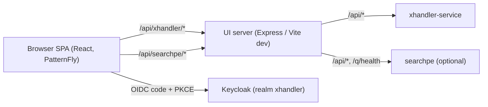

# Architecture

A high-level map of how the UI is structured. For the design decisions behind it see
[docs/adr/](../adr/); for the coding rules see [.rulesync/rules/](../../.rulesync/rules/).

## One shell, two backends

A React single-page app drives two independent REST APIs
([ADR 0001](../adr/0001-one-shell-two-backends.md)). The browser calls both on its own origin,
under one prefix each; the UI server (Express in production, Vite in development) proxies
`/api/xhandler/*` and `/api/searchpe/*` to the backends' `/api/*` (searchpe's health check to
`/q/health`). No CORS, and the browser never learns the backend URLs. searchpe is optional:
without `SEARCHPE_API_URL` its proxy, its navigation and its routes don't exist.

`ApiStatusProvider` polls `GET /api/v1/status` (xhandler, public) and searchpe's
`/q/health/ready`; each product's sidebar group shows only while its backend answers. Neither
blocks the shell.

## Authentication

OIDC only, through `react-oidc-context` / `oidc-client-ts` (authorization code with PKCE,
silent renew). `axios-config/apiInit.ts` builds one axios instance per backend; both add the
user's `Bearer` token and, on a `401`, renew the token silently and retry once (sign out if
renewal fails). A third instance, used by public pages, never carries a token
([ADR 0003](../adr/0003-public-and-authenticated-routes.md)).

Routes under `_authenticated/` start the login in `beforeLoad`; routes under `_public/` don't,
and render in a bare shell (`PublicLayout`).

## Data

- Generated clients (`@app/client/xhandler`, `@app/client/searchpe`) give the request functions
  and types ([api-clients.md](api-clients.md)).
- TanStack Query owns server state: one module per domain in `queries/xhandler/` and
  `queries/searchpe/`, each with a key factory, `*QueryOptions` factories, hooks and mutations
  that own their invalidation.
- List state (filters, sort, page) lives in the URL through `usePersistentState`
  ([ADR 0008](../adr/0008-view-state-persistence.md)).
- Zustand holds the little client state that outlives a page (`stores/useLastTenantStore.ts`:
  the sidebar's last tenant).

## Tenancy

xhandler pages carry the tenant (and company) in the URL
([ADR 0002](../adr/0002-navigation-partner-tenant-company.md)); `useSelectedTenantId()` is the
one hook that reads it, and tenant-scoped query hooks inject it.

## Permissions

`useSearchpePermissions` (from `whoami`) and `useTenantRole` (from the user's tenant
memberships) gate actions: disabled with a tooltip, never hidden
([ADR 0004](../adr/0004-identity-and-permissions.md)).
